<div align="center">

# Fitura+

**Workouts, nutrition and progress in one place, for people who train alone and for trainers who coach clients.**

English and Hebrew (full RTL) · Light and dark themes · Web, Android and iPhone

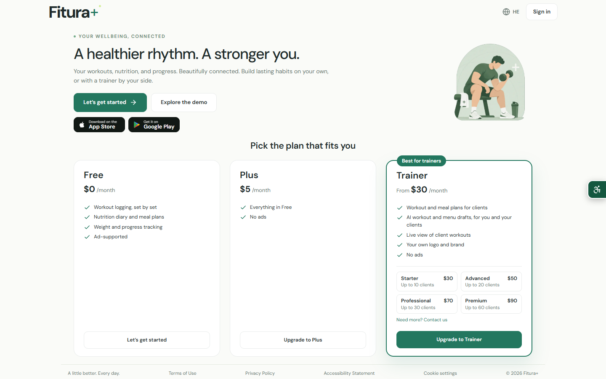

</div>

---

## Contents

- [What it does](#what-it-does)
- [Quick start](#quick-start)
- [How to use it](#how-to-use-it)
  - [Train: build and log a workout](#train-build-and-log-a-workout)
  - [Find exercises](#find-exercises)
  - [Eat: log food and follow a meal plan](#eat-log-food-and-follow-a-meal-plan)
  - [Track progress](#track-progress)
  - [Coach clients](#coach-clients)
  - [Language, theme and accessibility](#language-theme-and-accessibility)
- [Using the API](#using-the-api)
- [Configuration](#configuration)
- [npm scripts](#npm-scripts)
- [Project layout](#project-layout)
- [Testing](#testing)
- [Mobile app](#mobile-app)
- [Admin console](#admin-console)
- [Deployment](#deployment)
- [Data sources and licensing](#data-sources-and-licensing)
- [Keeping this README current](#keeping-this-readme-current)

---

## What it does

| Area | Highlights |
| --- | --- |
| **Workouts** | Step-by-step workout builder, rep ranges, supersets/groups, templates, weekly schedule, guided routine generator, live workout with set logging and automatic rest timer, personal records. |
| **Exercise library** | 1,029 exercises with looping animations, grouped by muscle (biceps, lats, quads, glutes…), filtered by body part and equipment, in English and Hebrew. |
| **Nutrition** | Food diary by meal, ~12,000-food local database (Hebrew + English), custom foods, recipes, water, copy yesterday, meal plans and dated menus, meal-photo recognition (AI). |
| **Progress** | Bodyweight with monthly trend, strength-volume charts, consistency calendar, steps and aerobic activity, JSON export of all your data. |
| **Coaching** | Client invitations with explicit consent, live view of client workouts, assigned workout and meal plans, messages, calendar and appointments, packages, client payments, monthly business report, your own brand logo, colour and background. |
| **AI** | Workout and menu drafts, fitness/nutrition questions. Works with OpenAI or any OpenAI-compatible provider (OpenRouter free models included). Trainees must confirm they are 18+ and opt in; trainers only opt in (running a coaching business implies an adult). Never changes your records on its own. |
| **Plans** | Free (with ads), Plus $5/month (no ads), Trainer from $30/month. Stripe and PayPal checkout. |

<table>
  <tr>
    <td width="50%">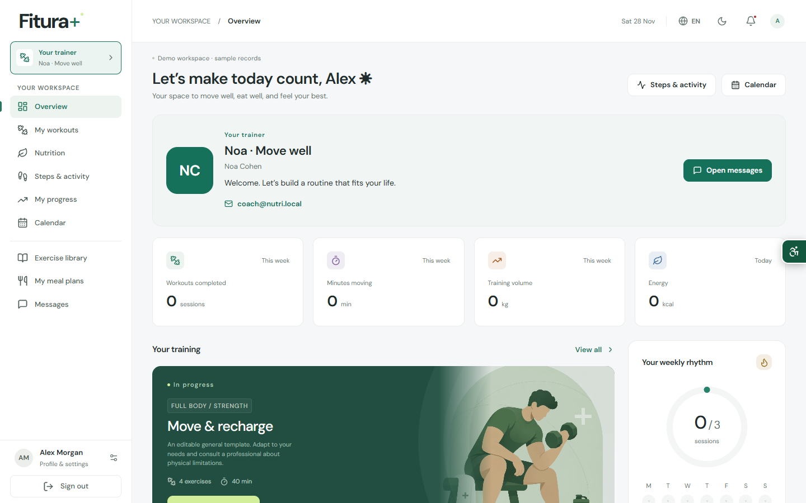<br><sub><b>Dashboard</b>: this week's workouts, minutes, volume and energy at a glance.</sub></td>
    <td width="50%">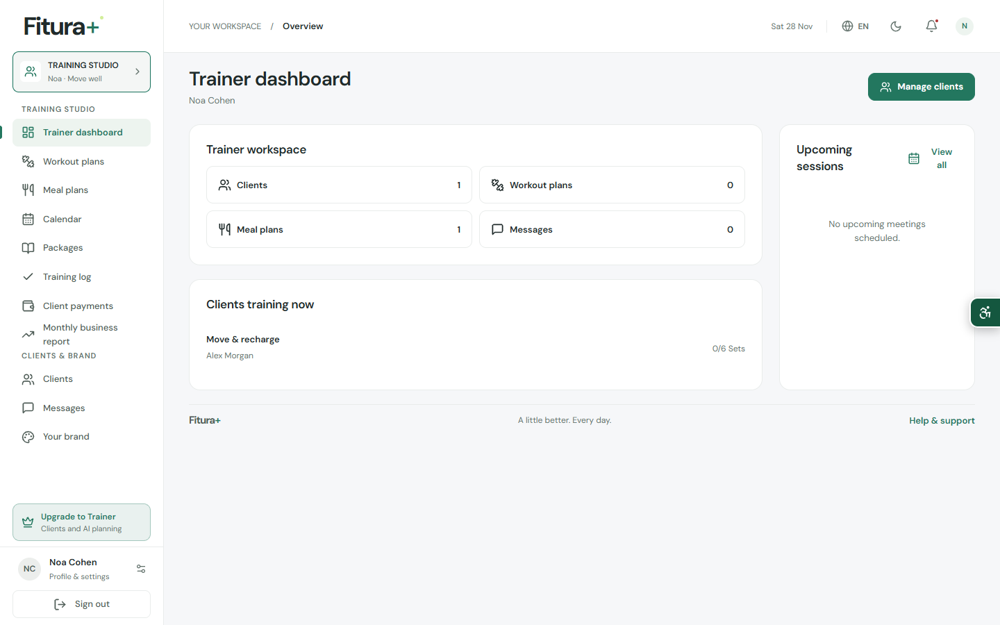<br><sub><b>Trainer dashboard</b>: clients, plans, who is training right now.</sub></td>
  </tr>
</table>

---

## Quick start

You need **Node.js 24 LTS** and npm.

```powershell
Copy-Item .env.example .env   # macOS/Linux: cp .env.example .env
npm ci
npm run setup                 # Prisma client, migrations, seed data, food database
npm run dev
```

Open <http://localhost:3000> and either:

- click **Explore the demo** on the sign-in page, or
- sign in with a seeded development account:

| Account | Email | Password |
| --- | --- | --- |
| Personal (trainee) | `alex@nutri.local` | `NutriDemo2026!` |
| Trainer (coach) | `coach@nutri.local` | `NutriCoach2026!` |

These accounts exist only in development with `DEMO_ENABLED=true`. In production, **Explore the demo** creates a private, temporary account for each visitor that is deleted after 24 hours (`src/lib/demo.ts`); set `DEMO_ENABLED=false` to turn it off.

> [!NOTE]
> Data lives in SQLite at `prisma/dev.db` and survives restarts. Don't delete it to "reset" the app. On Windows, stop the dev server before running `prisma generate`, because the Prisma engine DLL is locked while it runs.

---

## How to use it

### Train: build and log a workout

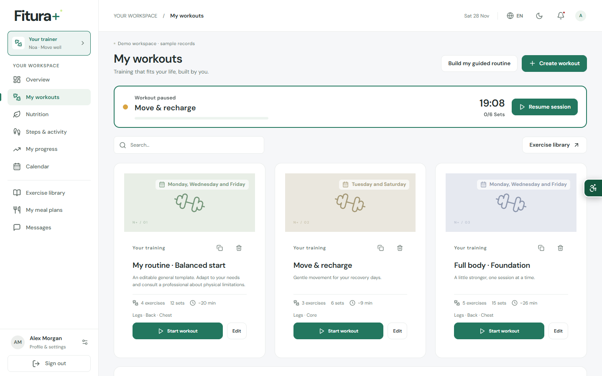

1. Open **My workouts**.
2. Either click **Build my guided routine** (creates an editable plan from your onboarding answers: experience, equipment, days per week, session length) or **Create workout**.
3. The builder has three steps: **Details → Exercises → Review**. Pick a quick name (Push day, Leg day…), the weekday, then add exercises with sets, reps or a rep range, rest and load. Tick **Save as template** to reuse it.

   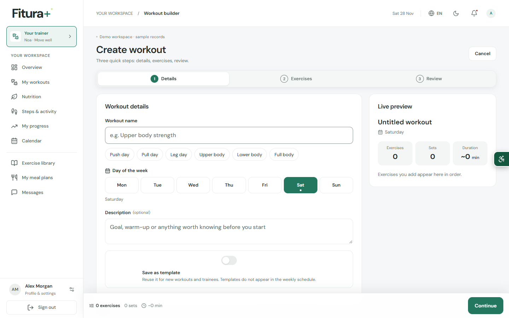

4. Press **Start workout**. Log weight and reps for each set; the rest timer starts on its own and moves you to the next exercise. You can pause, and an unfinished workout shows up as **Resume session**, even after a page refresh.
5. When you finish, you get a summary and any new personal records.

> The guided routine is deterministic programming logic, not AI and not medical advice.

### Find exercises

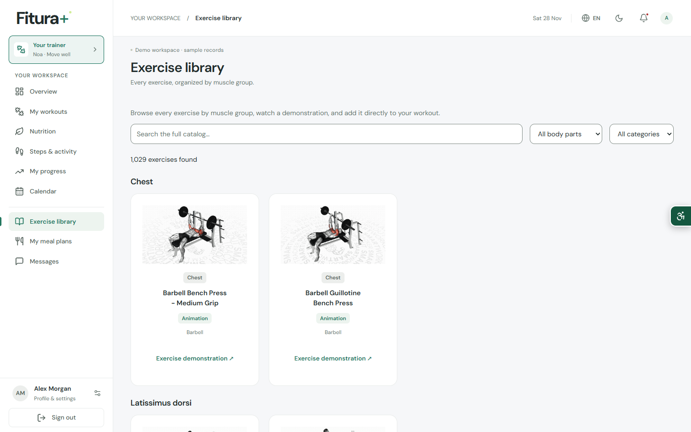

Open **Exercise library**, search (for example `preacher bench` or `romanian deadlift`) or filter by body part and equipment. Every result has a looping demonstration with play/pause; it pauses in hidden tabs and honours reduced motion. Add an exercise straight to a workout from its card.

### Eat: log food and follow a meal plan

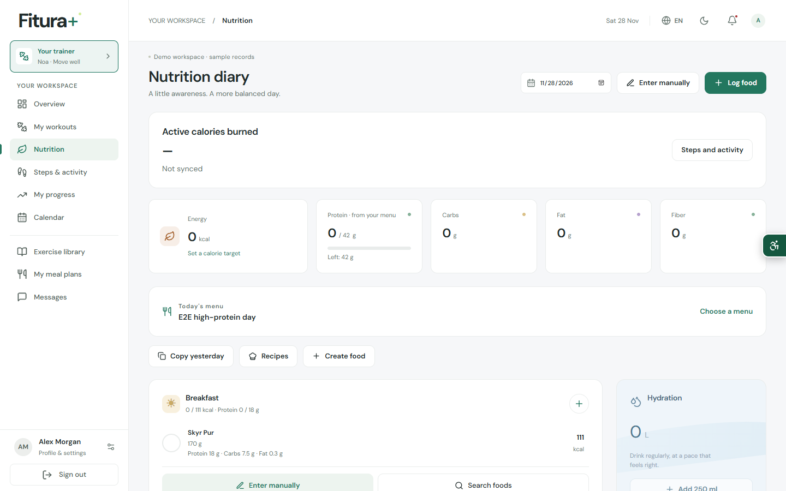

1. Open **Nutrition** and pick a date.
2. Click **Log food**, search the food database in Hebrew or English (`hummus`, `חומוס`, `shakshuka`), choose a unit or enter grams, and add it to breakfast, lunch, dinner or snacks.
3. Other shortcuts: **Enter manually** for a one-off item, **Create food** for your own per-100 g values, **Recipes**, **Copy yesterday**, and **Add 250 ml** under Hydration for water.
4. **Scan a meal** (camera button, needs AI access): take or choose a photo of your plate and pick the meal. The AI lists the foods with estimated grams; adjust or remove items, then press **Log meal**. Nothing is logged until you confirm, so check portions, because a photo can't show oil, sauces or what's under the top layer.
5. Under **My meal plans**, turn on a plan with **Active in my diary** so its meals appear in your day. A trainer can assign plans to you.

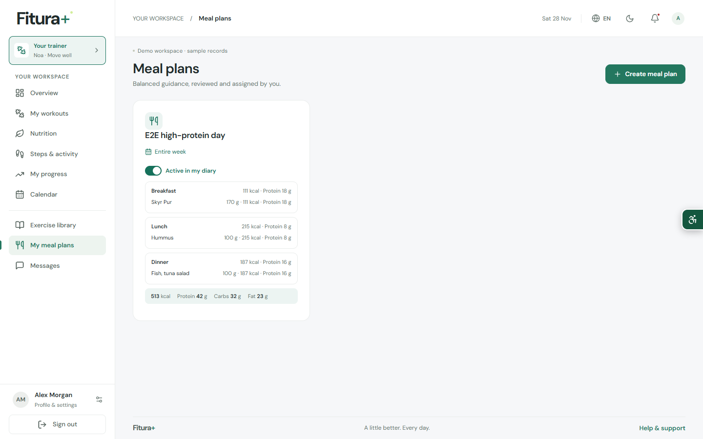

### Track progress

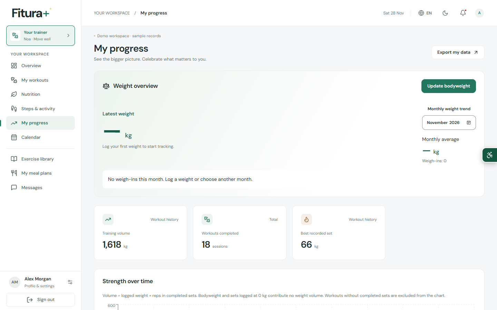

**My progress** shows your latest weight and monthly average, total training volume, workouts completed and best set, and a strength-over-time chart. Click **Update bodyweight** to log a weigh-in and **Export my data** to download everything as JSON. **Steps & activity** covers daily steps and aerobic sessions, entered by hand or synced from Apple Health / Health Connect in the phone app.

### Coach clients

Register a **Trainer** account (or sign in as `coach@nutri.local`):

1. **Clients → Invite client** and enter the email of an existing Fitura+ account. The client must accept before you can see anything; either side can end sharing at any time.
2. Create **Workout plans** and **Meal plans** and assign them to a client.
3. Watch the **Clients training now** panel on the dashboard while a client works out.
4. Use **Messages**, **Calendar** (appointments with conflict checks), **Packages**, **Training log**, **Client payments** and **Monthly business report** to run the business.
5. Under **Your brand**, set your business name, upload a logo and background image, and pick an accent colour and welcome text. Your clients see the app with your brand.

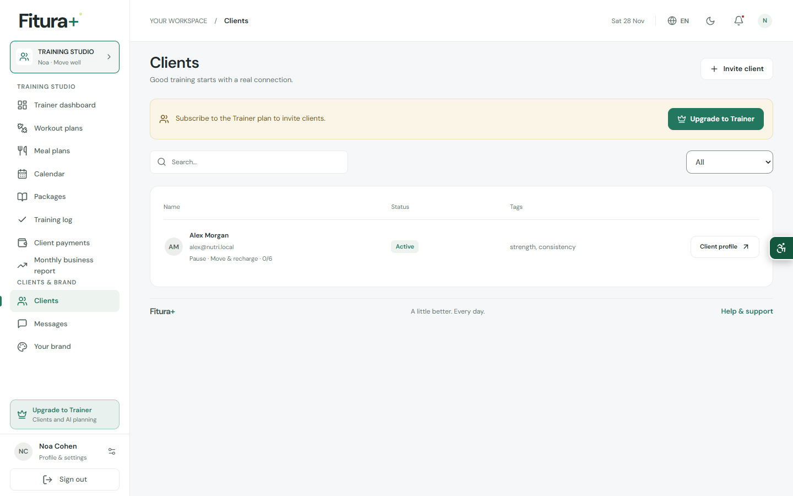

> Inviting clients requires an active Trainer plan once billing is configured. In development without billing, coach accounts are treated as paid.

### Language, theme and accessibility

Use the globe button for **English / עברית** (the whole layout flips to RTL) and the moon button for dark mode. Both are saved to your account. The accessibility button on the side of every page has switches for text zoom, high contrast, highlighted links, a readable font, reduced motion and grayscale. Drag the button up or down either edge of the screen (or press Alt + arrow keys while it has focus) to move it, and use **Hide button** in the menu to tuck it into a slim tab on the edge; press the tab to bring it back. Its position is remembered in your browser.

<p align="center">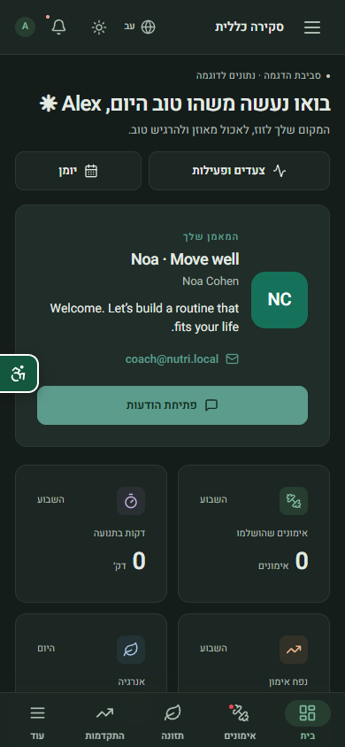</p>

---

## Using the API

Everything the UI does goes through a JSON API under `/api/`. Authentication is the `nutri_session` HttpOnly cookie; mutations are `POST` with JSON. Full reference: [docs/API.md](docs/API.md).

```bash
# Sign in and keep the session cookie
curl -c jar.txt -H "Content-Type: application/json" \
  -d '{"email":"alex@nutri.local","password":"NutriDemo2026!"}' \
  http://localhost:3000/api/auth/login

# Everything for one day: workouts, meals, water, progress, messages…
curl -b jar.txt "http://localhost:3000/api/state?date=2026-11-28"

# Search the local food database (no external calls)
curl -b jar.txt "http://localhost:3000/api/foods/search?q=hummus"

# Add 150 g of a food to lunch
curl -b jar.txt -H "Content-Type: application/json" \
  -d '{"foodId":"<id from search>","grams":150,"meal":"lunch","date":"2026-11-28"}' \
  http://localhost:3000/api/meals/add

# Log 250 ml of water
curl -b jar.txt -H "Content-Type: application/json" \
  -d '{"ml":250,"date":"2026-11-28"}' http://localhost:3000/api/water
```

Requests from a foreign browser origin are rejected on mutation. Errors come back as localized keys, for example `{"error":"notFound"}`.

---

## Configuration

Copy [.env.example](.env.example) to `.env`. Only `DATABASE_URL` is needed to run locally; everything else switches on an optional integration.

| Variable(s) | Purpose |
| --- | --- |
| `DATABASE_URL` | SQLite file, default `file:./dev.db`. The container uses `file:/data/nutri.db`. |
| `APP_URL` | Trusted public origin. Needed for email links, checkout and webhooks. |
| `DEMO_ENABLED` | Seeded demo accounts in development; temporary demo accounts in production. |
| `OPENAI_API_KEY`, `OPENAI_MODEL`, `OPENAI_BASE_URL`, `OPENAI_FALLBACK_MODEL`, `OPENAI_VISION_MODEL` | AI text and meal-photo recognition. Any OpenAI-compatible API works; for OpenRouter free models set `OPENAI_BASE_URL=https://openrouter.ai/api/v1`. Keys can also be managed in the admin console. |
| `RESEND_API_KEY`, `EMAIL_FROM` | Verification and password-reset email. Production sign-up stays closed until these and `APP_URL` are set. |
| `STRIPE_*` | Card subscriptions; see [docs/BILLING.md](docs/BILLING.md). |
| `PAYPAL_*` | PayPal subscriptions; `PAYPAL_ENV=live` for real payments, otherwise sandbox. `npx tsx scripts/paypal-setup.ts` creates the plans and webhook. |
| `ADSENSE_CLIENT`, `ADSENSE_SLOT` | Google AdSense for Free-plan users only. Home and sign-in pages stay ad-free. |
| `ADMIN_HOST`, `ADMIN_ENCRYPTION_KEY`, `CRON_SECRET`, … | Admin console host, encryption of TOTP seeds and AI keys (32 bytes, required in production), scheduled jobs. See [docs/ADMIN.md](docs/ADMIN.md). |
| `NEXT_PUBLIC_PRIVACY_EMAIL`, `NEXT_PUBLIC_ACCESSIBILITY_*` | Contacts shown on the privacy and accessibility statement pages. |

Never prefix a secret with `NEXT_PUBLIC_`; those values are baked into the browser bundle.

---

## npm scripts

| Command | What it does |
| --- | --- |
| `npm run dev` | Dev server on port 3000, reachable on your LAN (for the phone app). |
| `npm run build` / `npm start` | Production build / start (the start script also prepares the database). |
| `npm run setup` | Generate Prisma client, migrate, seed and load foods. Safe to rerun. |
| `npm run db:migrate` | Create the database file if needed and apply migrations. |
| `npm run db:seed` | Seed libraries (and demo accounts when enabled). |
| `npm run db:foods` | Load `src/data/food-database.json` into the database (offline, idempotent). |
| `npm run catalog:foods` | Rebuild the food database from its sources (downloads, resumable). |
| `npm run catalog:smartworkout` → `catalog:thumbnails` → `catalog:gifs` | Refresh the exercise animation index, previews and looping GIFs. |
| `npm run catalog:translate` | Rebuild exercise catalog translations and apply the Hebrew glossary. |
| `npm run admin:provision -- --email you@example.com --name "You"` | Create the first Super Admin; prints a one-time setup link. |
| `npm run photos:encrypt` | Encrypt existing progress photos at rest. |
| `npm run docs:screenshots` | Regenerate the screenshots in this README (dev server must be running). |
| `npm test`, `npm run typecheck`, `npm run test:api`, `npm run test:e2e`, `npm run test:admin` | See [Testing](#testing). |

---

## Project layout

```text
src/
  app/                 Next.js 16 App Router
    page.tsx           public home page with pricing
    auth/              sign-in, registration, password reset
    app/[[...slug]]/   the signed-in workspace (/app, /app/workouts, /app/nutrition…)
    admin/             admin console (separate accounts and host)
    api/[...path]/     JSON API
  components/          React UI (workspace.tsx is the shell; workouts, nutrition, coach…)
  lib/                 server and shared logic: auth, plans, billing, ai, i18n, food search…
  data/                bundled exercise catalog and food database
prisma/                schema, migrations, seed
scripts/               catalog builders, admin provisioning, Hostinger start, screenshots
mobile/                Expo app for Android and iPhone
tests/                 unit (*.test.ts), API/admin integration, browser/ (Playwright)
docs/                  API, architecture, billing, admin, deployment, features, compliance
deploy/                production compose stack, Caddy, deploy script
```

Stack: Next.js 16, React 19, TypeScript, Prisma + SQLite, Zod, Recharts, Lucide icons.

---

## Testing

```powershell
npm test              # unit tests
npm run typecheck
npm run build
# With npm run dev running on port 3000:
npm run test:api      # API integration
npm run test:e2e      # Playwright browser tests
```

Browser tests use the installed Microsoft Edge on Windows and Playwright Chromium on Linux (`npx playwright install --with-deps chromium` first). Screenshots go to `test-results/`. The tests create and delete their own accounts. Run them against a development or disposable CI database, never production.

---

## Mobile app

The Android and iPhone app lives in [mobile/](mobile/README.md). It is an Expo app that opens the Fitura+ workspace in a native window and adds native extras: local rest-timer alerts, Apple Health / Health Connect step and workout sync, AdMob for Free accounts.

```powershell
npm run dev                      # backend, from the repo root
cd mobile; npm ci; npm start -- --go --lan
```

Scan the QR code with Expo Go on a phone on the same Wi-Fi. The App Store and Google Play badges on the home page are placeholders that do nothing when clicked until the store listings are published. Health sync and ads need a native build (`npx eas-cli build --profile preview --platform android`), not Expo Go. Details: [mobile/README.md](mobile/README.md).

---

## Admin console

A separate console at `/admin` with its own accounts, mandatory two-step verification and audit log. It covers users, coaches, support tickets, subscriptions and promotions, ads, AI providers and budgets, content and translations, announcements, remote config and system health. In production it runs as a separate deployment on its own host, sharing the database. Start with `npm run admin:provision` and read [docs/ADMIN.md](docs/ADMIN.md).

---

## Deployment

- **Docker:** `docker compose up --build -d` (single instance, persistent SQLite volume, port 3000 behind a TLS proxy).
- **Hostinger:** the standalone server (`scripts/hostinger-start.mjs`) initializes the SQLite file, runs migrations and seeds on startup; data defaults to `~/fitura-data` (`HOSTINGER_DATA_DIR`).
- Run one writer per SQLite database. To scale horizontally, move to PostgreSQL first.
- Start production with an empty database. Never copy the development database.

Read [docs/DEPLOYMENT.md](docs/DEPLOYMENT.md) and [docs/ARCHITECTURE.md](docs/ARCHITECTURE.md) before going live, and [docs/FEATURES.md](docs/FEATURES.md) for what is complete, partial or pending.

---

## Data sources and licensing

- **Exercise demonstrations** load directly from [SmartWorkout](https://smartworkout.app/en/exercise-library) and need internet access and continued upstream availability. This is a public-media integration, not a redistributable open-licence dataset. Exercises without a demonstration are excluded from the library and from new workouts; finished workout history is kept.
- **Food database** (~12,000 foods, one per name, generic foods first):
  - **Tzameret**, Israel Ministry of Health national food composition database (data.gov.il, open licence, native Hebrew names).
  - **USDA FoodData Central** Foundation + FNDDS (public domain, machine-translated names).
  - **Open Food Facts** products sold in Israel (ODbL; attribution shown in the food picker; derived data must stay under ODbL).

  Search runs only against this local database, with no external calls at runtime. CalorieKing data needs a commercial licence and is not included. Values are per 100 g; always check product labels.
- Not yet integrated: WhatsApp Business, barcode scanning, calendar sync, object storage. The UI never claims these succeeded.

---

## Keeping this README current

This README is updated together with the code. When a commit adds or changes something a user, trainer or developer would notice (a feature, a screen, a command, an environment variable, a setup step), update the matching section here in the same commit. If a screen changed visibly, regenerate the images:

```powershell
npm run dev                       # in one terminal
npm run docs:screenshots          # all screens, or: home | personal | coach
```

Screenshots are written to [docs/images/](docs/images/).
